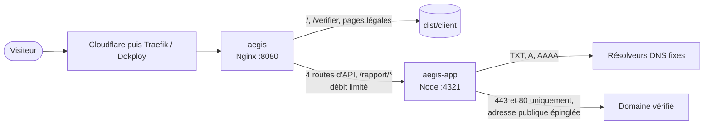

<div align="center">

# Aegis

**Analyse la posture de sécurité de tes domaines.**
Un analyseur défensif de sécurité web, construit avec Astro et React : HTTPS et TLS, en-têtes HTTP, CSP, cookies,
redirections et cache, uniquement sur un domaine dont la propriété a été prouvée par DNS.

[](https://astro.build)
[](https://react.dev)
[](https://www.typescriptlang.org)
[](https://ui.shadcn.com)
[](https://pnpm.io)
[](https://www.docker.com)
[](https://nginx.org)
[](LICENSE)

[Fonctionnalités](#fonctionnalités) · [Architecture](#architecture) · [Vérification](#vérification-de-propriété) · [Scanner](#scanner-défensif) · [Démarrage](#démarrage) · [Tests](#tests) · [Déploiement](#déploiement) · [Sécurité](#sécurité) · [Non-indexation](#non-indexation)

</div>

---

## Fonctionnalités

- **Accueil** (`/`) : fonctionnement en trois étapes (vérifier, analyser, corriger), aperçu d'un rapport fictif
  produit par le vrai moteur d'analyse sur le domaine réservé `mon-site.example`, catégories analysées, limites.
- **Vérification** (`/verifier`) : saisie d'un nom d'hôte seul, normalisation IDN, challenge DNS TXT copiable,
  aide contextuelle (panneau latéral sur ordinateur, tiroir sur mobile), suivi de la propagation, preuve de propriété
  temporaire puis confirmation explicite avant l'analyse.
- **Rapport** (`/rapport/[id]`) : score indicatif sur 100 détaillé par catégorie, contrôles conformes, recommandations
  et problèmes importants, onglets HTTPS et TLS, en-têtes, CSP, cookies, redirections et recommandations priorisées,
  export JSON local et impression ou PDF via le navigateur. Le rapport est privé, temporaire et non indexé.

Aegis n'est pas un outil de test d'intrusion : il ne scanne aucun port, n'énumère ni sous-domaines ni répertoires,
n'envoie aucune charge d'attaque, ne tente aucune authentification et ne teste aucune version TLS obsolète.

## Architecture

| Service | Image                         | Réseaux              | Rôle                                                           |
|---------|-------------------------------|----------------------|----------------------------------------------------------------|
| `aegis` | `nginx-unprivileged` (Alpine) | `internal`, Dokploy  | Sert les pages statiques et relaie les seules routes dynamiques |
| `aegis-app` | `node` (Alpine)           | `internal`, `egress` | Serveur Astro autonome : vérification DNS, scanner, rapports    |



```text
src/
├── components/
│   ├── audit/           Rapport : score, résumé, contrôles, TLS, en-têtes, CSP, cookies, redirections
│   ├── verification/    Parcours : domaine, challenge DNS, statut, lancement de l'analyse
│   ├── layout/          En-tête, pied de page, logo, thème, SEO, page introuvable
│   └── ui/              Composants shadcn/ui, Toast, Drawer et CopyButton
├── data/                Métadonnées du site, textes légaux, rapport fictif
├── domain/
│   ├── audit/           Analyseurs purs, score, recommandations, modèle du rapport
│   ├── domain/          Validation et normalisation des noms d'hôte
│   └── verification/    Challenge, politique d'expiration, schémas des jetons signés
├── hooks/               Hooks React (parcours de vérification, rapport, horloge)
├── lib/
│   ├── client/          Client de l'API avec validation Zod des réponses
│   ├── crypto/          Jetons aléatoires, empreintes, jetons signés HMAC
│   ├── http/            Réponses, garde CSRF, cookies, en-têtes de sécurité
│   ├── network/         Politique d'adresses, redirections, connexions épinglées (protection SSRF)
│   ├── state/           Stockage éphémère borné et limitation de débit
│   └── validation/      Schémas Zod de l'API et du rapport
├── pages/               Pages et API
├── services/
│   ├── audits/          Orchestration d'une analyse et stockage temporaire des rapports
│   ├── dns/             Résolveur DNS contrôlé
│   ├── scanner/         Client HTTP borné, suivi des redirections, scan
│   ├── tls/             Inspection TLS
│   └── verification/    Émission et confirmation des challenges
└── styles/              Tokens et styles globaux
scripts/                 En-têtes Nginx, pare-feu de sortie, certificats de test
tests/                   Tests unitaires, d'intégration et end-to-end
```

Les analyseurs de `domain/` sont des fonctions pures : ils reçoivent des observations normalisées et produisent des
contrôles. Les composants n'affichent que des données déjà validées et ne contactent jamais une cible externe.

### API

| Route                                 | Entrée                | Rôle                                                       |
|---------------------------------------|-----------------------|------------------------------------------------------------|
| `POST /api/verification/challenge`    | `{ "domain": "…" }`   | Normalise le domaine, crée le challenge et les cookies     |
| `POST /api/verification/confirm`      | `{}`                  | Lit le TXT, délivre la preuve de propriété en cas de succès |
| `POST /api/audits`                    | `{ "domain": "…" }`   | Lance l'analyse si la preuve est valide, renvoie l'identifiant |
| `GET /api/audits/[id]`                | identifiant du rapport | Renvoie le rapport à la seule session qui l'a créé          |

Chaque route limite ses méthodes, valide son corps avec un schéma Zod strict (1 Kio au plus), exige
`application/json` ainsi qu'une origine identique (`Origin` et `Sec-Fetch-Site`), répond en `no-store` et ne renvoie
qu'un message d'erreur générique avec un code stable.

## Vérification de propriété

1. Le domaine saisi est validé avant toute conversion : URL, protocole, chemin, port, identifiants, adresse IP et
   joker sont refusés. Il est ensuite converti en ASCII (IDN), contrôlé label par label, puis comparé à la Public Suffix
   List (`tldts`) : seuls les domaines enregistrables d'une extension ICANN sont acceptés, à l'exclusion des noms
   réservés (`localhost`, `.local`, `.internal`, `.test`, `example.com`, `.arpa`…).
2. Aegis génère un jeton de 256 bits et demande de créer l'enregistrement `TXT _aegis-verify.<domaine>`.
3. Le cookie `__Host-aegis-challenge` (`HttpOnly`, `Secure`, `SameSite=Strict`, signé HMAC-SHA-256) contient le domaine,
   l'identifiant du challenge, son expiration (30 minutes) et l'empreinte SHA-256 du jeton liée au challenge et au
   domaine, jamais le jeton lui-même.
4. La confirmation interroge le résolveur fixe sur le seul nom exact, compare les empreintes en temps constant, impose
   5 secondes entre deux essais et 10 essais au plus. Le challenge est invalidé après succès.
5. Le cookie `__Host-aegis-proof`, valable 15 minutes, lie la preuve au domaine exact et à la session.

Les clés de signature sont dérivées par HKDF de `AEGIS_SECRET`, une par usage (session, challenge, preuve).

## Scanner défensif

La preuve de propriété ne suffit pas à rendre une connexion sûre. Avant chaque socket, Aegis :

- résout le nom via des résolveurs fixes (`AEGIS_DNS_SERVERS`), jamais via `/etc/hosts` ni le résolveur système ;
- refuse la réponse entière si une seule adresse est interdite : boucle locale, réseaux privés, lien local et
  métadonnées cloud, CGNAT, multidiffusion, réservé, documentation, tests, IETF, AS112, 6to4, Teredo, NAT64, IPv6 locale,
  unique locale et lien local, ainsi que toute adresse IPv4-mapped ou compatible, plus strictement que nécessaire ;
- épingle une adresse par nom d'hôte pour toute l'analyse (TLS, HTTPS, HTTP et redirections) contre le rebinding DNS,
  revérifie l'adresse juste avant la connexion et se connecte directement à l'IP avec le SNI et l'en-tête `Host` ;
- n'utilise aucun agent HTTP, donc aucun proxy d'environnement, et seulement les ports 443 et 80.

Les requêtes visent uniquement `https://<domaine>/` (et `http://<domaine>/` pour la redirection initiale), en `HEAD`
avec repli sur `GET`, avec des en-têtes limités à 32 Kio, 6 secondes par requête et 25 secondes par analyse. Une
seule requête `GET` lit ensuite l'en-tête HTML de la page finale (64 Kio au plus, arrêt à `</head>`, sans
décompression) pour y trouver une CSP déclarée en balise `<meta>`, comme celles générées par Astro ; les directives
que les navigateurs ignorent dans ce cas (`frame-ancestors`, `report-uri`, `sandbox`) sont écartées. Au plus cinq redirections sont suivies, chacune revalidée : schéma HTTP(S), sans identifiants,
sans port explicite, sans IP brute, dans le domaine vérifié ou ses sous-domaines, sans retour vers HTTP ni boucle.

Le service TLS valide toujours la chaîne et le nom d'hôte (TLS 1.2 minimum) et rapporte l'erreur rencontrée sans
jamais la contourner. Une seule analyse est active par session, trois au plus en parallèle, avec des quotas par
session, par domaine et par adresse IP.

Aucune valeur de cookie n'est conservée : le nom est coupé au premier `=` et le reste ignoré. Les paramètres d'URL
observés sont masqués, les noms et valeurs sont bornés et débarrassés des caractères de contrôle.

### Score

| Catégorie                          | Poids |
|------------------------------------|------:|
| HTTPS, certificat et redirections  |    25 |
| TLS négocié                        |    10 |
| En-têtes HTTP de sécurité          |    25 |
| CSP                                |    20 |
| Cookies                            |    15 |
| Cache et informations exposées     |     5 |

Dans chaque catégorie, un contrôle pèse selon sa priorité (critique 6, élevée 4, moyenne 2, faible 1, information 0).
Un contrôle conforme rapporte tous ses points, une recommandation la moitié, un problème aucun. Une catégorie non
évaluable faute de réponse HTTPS ne rapporte rien. Le score est indicatif et n'a aucune valeur de certification.

## Démarrage

### Prérequis

- [Node.js](https://nodejs.org) 22.23.4 ou plus récent
- [pnpm](https://pnpm.io) 12 (la version exacte est fixée dans `packageManager`)

```bash
pnpm install
cp .env.example .env
node -e "console.log(require('node:crypto').randomBytes(32).toString('base64url'))"
```

Colle la valeur générée dans `AEGIS_SECRET` (au moins 43 caractères). `AEGIS_DNS_SERVERS` liste les résolveurs
utilisés pour la vérification et l'analyse.

### Scripts

| Commande          | Rôle                                                      |
|-------------------|-----------------------------------------------------------|
| `pnpm dev`        | Serveur de développement                                  |
| `pnpm check`      | Vérification TypeScript et Astro                          |
| `pnpm build`      | Vérification puis build de production                     |
| `pnpm preview`    | Lance le serveur Node construit                           |
| `pnpm test`       | Tests unitaires et d'intégration (Vitest)                 |
| `pnpm test:e2e`   | Tests d'API et end-to-end, ordinateur et mobile (Playwright) |

## Tests

- **Unitaires** : normalisation des domaines et rejet des URL, IP, ports, chemins et identifiants, IDN, chaque plage
  d'adresses interdite (première et dernière adresse), redirections dangereuses, jetons signés et expiration,
  empreintes du challenge, analyseurs d'en-têtes, de CSP, de cookies sans valeur, de cache, de transport et de TLS,
  score, classement des recommandations, stockage éphémère et limitation de débit.
- **Intégration (Vitest)** : un vrai serveur HTTPS local avec des certificats de test, derrière un connecteur qui
  associe une adresse publique fictive au port local. Couvre le scan complet, le repli `GET`, les redirections
  autorisées et refusées sans contact de la destination, le rebinding DNS, les certificats expirés, auto-signés ou
  non concordants, les réponses anormales, les délais, le parcours de vérification, l'expiration, la réutilisation
  d'un challenge, l'analyse sans preuve, les quotas et l'accès aux rapports limité à la session.
- **Intégration (Playwright)** : endpoints réels, cookies durcis, CSRF, corps invalides, méthodes, en-têtes de
  sécurité, absence de fuite d'information, non-indexation et limitation de débit.
- **End-to-end** : saisie valide et invalide, challenge copiable, attente de propagation, persistance au rechargement,
  confirmation, lancement de l'analyse, rapport, états de chargement, vide et d'erreur, thèmes, mobile, navigation au
  clavier et export JSON.

Les certificats de `tests/fixtures/tls` servent uniquement aux tests et se régénèrent avec
`sh scripts/generate-test-certificates.sh`.

## Déploiement

Aegis se déploie comme les autres projets, avec Dokploy, dans une application **Docker Compose** dédiée
(fichier `compose.yaml`, cible de build multi-stage). Les variables saisies dans l'onglet **Environment** sont
écrites dans le `.env` lu par Compose : `AEGIS_SECRET` est obligatoire, `AEGIS_DNS_SERVERS` facultative.

Le domaine se déclare dans l'onglet **Domains** sur le service `aegis`, port `8080` : Dokploy ajoute alors le
réseau `dokploy-network` et les labels Traefik à ce seul service. Laisse **Isolated Deployments** désactivé.

| Service     | Réseaux                                 | Accès                                                  |
|-------------|-----------------------------------------|--------------------------------------------------------|
| `aegis`     | `internal`, `dokploy-network` (ajouté) | Reçoit le trafic de Traefik, relaie vers `aegis-app`   |
| `aegis-app` | `internal`, `egress`                    | Seul service autorisé à sortir, via le pont `aegis-egress` |

Le réseau `internal` n'a aucun accès extérieur. Le réseau `egress` (pont `aegis-egress`, IPv6 désactivé) est le
seul accès sortant du scanner. Sur l'hôte, deux règles le confinent, pour ce pont uniquement :

- `scripts/egress-firewall.sh` crée la chaîne `AEGIS-EGRESS` dans `DOCKER-USER`, que ufw ne gère pas : DNS vers
  les résolveurs configurés, ports 80 et 443 vers des adresses publiques, tout le reste refusé, réseaux internes et
  métadonnées cloud compris. Les règles portent sur la destination d'origine (conntrack), avant la redirection
  Docker : un site hébergé sur le même serveur reste analysable via son IP publique, sans ouvrir l'accès direct
  aux conteneurs. Le script est idempotent (`apply`, `status`, `remove`) et l'unité
  `scripts/aegis-egress.service` le réapplique au démarrage, après Docker et ufw ;
- une règle ufw interdit toute connexion du scanner vers l'hôte lui-même (interface Dokploy, SSH, autres services) :
  `ufw insert 1 deny in on aegis-egress`.

Ces barrières d'infrastructure complètent la protection applicative sans la remplacer.

L'état (tentatives, challenges consommés, rapports) vit en mémoire : un redéploiement efface les rapports en cours,
et un déploiement sur plusieurs instances nécessiterait un stockage partagé.

## Sécurité

<details>
<summary><strong>Application</strong></summary>

- Content Security Policy à base d'empreintes générée par Astro, sans `unsafe-inline` ni `unsafe-eval`, complétée par
  `frame-ancestors 'none'`, `object-src 'none'`, `base-uri 'self'` et `form-action 'self'`. Aucun attribut `style`
  n'est rendu côté serveur ; `sonner` et `vaul`, qui injectent des balises `<style>`, sont remplacés par `Toast` et
  `Drawer` construits sur les primitives Radix.
- Protection CSRF : cookies `SameSite=Strict`, origine et `Sec-Fetch-Site` vérifiés, `application/json` obligatoire.
- Cookies préfixés `__Host-`, `HttpOnly`, `Secure`, `SameSite=Strict`, signés et de courte durée.
- Identifiants de rapport de 256 bits, rapports liés à la session, expirés après 30 minutes, réponses `no-store`.
- Validation Zod de chaque entrée, des réponses de l'API côté client et du stockage de session du navigateur.
- Journaux structurés limités à des valeurs primitives : ni domaine, ni adresse IP, ni jeton, ni cookie.
- Aucun script tiers, polices auto-hébergées, aucune base de données ni compte utilisateur.

</details>

<details>
<summary><strong>Nginx</strong></summary>

- Liste blanche des routes dynamiques et méthodes autorisées par route, `405` avec `Allow` sinon.
- Limitation de débit par adresse IP : vérification (12 par minute), analyses (2 par minute et une connexion
  simultanée), rapports et pages, avec une réponse `429` structurée.
- Corps de requête limité à 1 Kio, en-têtes `X-Forwarded-Host` et `X-Forwarded-Port` du client effacés.
- En-têtes de sécurité générés au build depuis `src/lib/http/security-headers.ts`, source unique partagée avec le
  middleware Node : HSTS, CSP, `X-Content-Type-Options`, `X-Frame-Options`, `X-Robots-Tag`, `Referrer-Policy`,
  `Permissions-Policy`, `Cross-Origin-Opener-Policy` et `Cross-Origin-Resource-Policy`.

</details>

<details>
<summary><strong>Conteneurs</strong></summary>

- Images de base fixées par version et par empreinte SHA-256, lockfile obligatoire (`--frozen-lockfile`).
- Scripts d'installation des dépendances refusés par défaut (`allowBuilds` dans `pnpm-workspace.yaml`).
- Gestionnaires de paquets retirés de l'image d'exécution, contexte de build en liste blanche.
- Utilisateurs non root, fichiers applicatifs appartenant à `root`, système de fichiers en lecture seule, `tmpfs`
  pour `/tmp`, `cap_drop: ALL`, `no-new-privileges`, limites de CPU, de mémoire et de processus, health checks et
  journaux plafonnés.

</details>

Aucune configuration ne garantit l'absence totale de faille. Tu as trouvé une vulnérabilité ? Signale-la en privé
via le [formulaire de contact](https://paulviandier.com/contact) plutôt que d'ouvrir une issue publique.

## Non-indexation

Le sous-domaine demande à ne pas être indexé : balise `<meta name="robots" content="noindex, nofollow, noarchive,
nosnippet">` sur chaque page, en-tête `X-Robots-Tag` identique sur chaque réponse, aucun sitemap, aucune URL
canonique, aucun outil de suivi. Ces mesures restent déclaratives ; les rapports, eux, sont réellement privés.

## Licence

© 2026 Paul Viandier. Tous droits réservés. Consulte le fichier [`LICENSE`](LICENSE) pour le détail.
